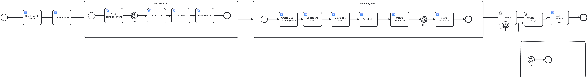
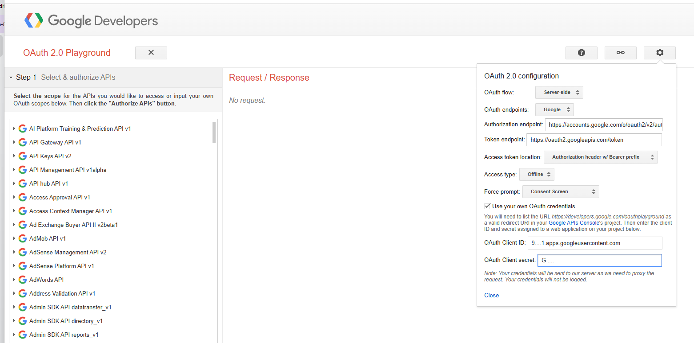
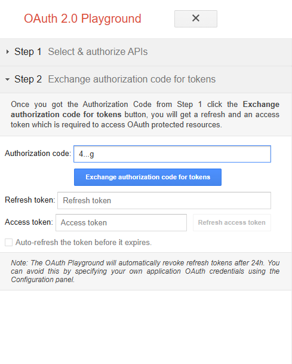

[](https://github.com/Camunda-Community-Hub/community/blob/main/extension-lifecycle.md#stable-)
[](https://github.com/camunda-community-hub/community)


# camunda-8-connector-googlecalendar


A Camunda 8 **outbound connector** to manage events in Google Calendar: create, update and delete events (including individual occurrences of recurring events), invite attendees, and generate Google Meet links.

- Connector type: `c-google-calendar-function`
- Applies to: `bpmn:ServiceTask`
- Element template: [element-templates/googlecalendar-function.json](element-templates/googlecalendar-function.json)
 


# Functions

The connector exposes one task with a `calFunction` selector:

| Function           | Description                                                                                     |
|--------------------|-------------------------------------------------------------------------------------------------|
| `CREATE`           | Create a new event in a calendar (single or recurring)                                          |
| `UPDATE`           | Update an existing event (or one specific occurrence, by passing the occurrence ID as event ID) |
| `DELETE`           | Delete an event                                                                                 |
| `UPDATEOCCURRENCE` | Update all occurrences of a recurring event in a period (new values, or just a new time of day) |
| `DELETEOCCURRENCE` | Delete all occurrences of a recurring event in a period                                         |
| `GETEVENT`         | Return the full description of one event                                                        |
| `SEARCHEVENT`      | Return all events of a calendar in a period                                                     |

# Authentication

The connector authenticates against the Google Calendar API with **OAuth2** and needs three values: a **Client ID**, a **Client Secret**, and a **Refresh Token**. These values are *not* found in Google Calendar itself — they come from the Google Cloud Console and a one-time OAuth consent flow. Only the *Calendar ID* comes from Google Calendar.

## 1. Client ID and Client Secret (Google Cloud Console)

1. Go to [console.cloud.google.com](https://console.cloud.google.com) and create (or select) a project. Sign in with the Google account that owns the calendar.
2. **APIs & Services → Library** → search for "Google Calendar API" → **Enable**.
3. **APIs & Services → OAuth consent screen** → configure it. With a Google Workspace account, choose **Internal** (simpler). Add the scope `https://www.googleapis.com/auth/calendar`.
4. **APIs & Services → Credentials → Create Credentials → OAuth client ID** → type **Web application**. Copy the generated **Client ID** and **Client Secret**.

### Using a personal (gmail.com) account

With a personal Google account, the **Internal** consent screen type is not available (it is Workspace-only). The setup differs in two points:

1. On the OAuth consent screen (on newer consoles: "Google Auth Platform"), the only available type is **External** — that's expected. Fill in the minimum: an app name (e.g. "Camunda Calendar"), your email as support and developer contact, the scope `https://www.googleapis.com/auth/calendar`, and add your own Gmail address as a **test user**.
2. An External app starts in **Testing** status, and in Testing status **refresh tokens expire after 7 days** — useless for a connector. In the "Audience" / publishing section, click **Publish app** (status "In production"). Google mentions app verification; you can skip it — verification is only required for public apps. The only consequence is a *"Google hasn't verified this app"* warning during the consent flow (click **Advanced → Go to [your app name] (unsafe)** — it is your own app). The refresh token then lives indefinitely.

> ⚠️ **Protect your real calendar while testing.** The scope `https://www.googleapis.com/auth/calendar` grants full read/write on all your calendars, and the DELETE/DELETEOCCURRENCE functions really delete events. Create a dedicated secondary calendar (e.g. "Camunda tests") in your account and pass its ID as `calendarId`/`sourceCalendarId`, so a mis-parameterized test cannot touch your actual appointments.

## 2. Refresh Token (one-time OAuth consent flow)

The easiest way is the [Google OAuth 2.0 Playground](https://developers.google.com/oauthplayground):

1. In the Cloud Console, add `https://developers.google.com/oauthplayground` to the **Authorized redirect URIs** of the OAuth client created above.
2. In the Playground, click the gear icon → check **Use your own OAuth credentials** → paste your Client ID and Client Secret.



3. In *Step 1*, find **Calendar API v3**, select the scope `https://www.googleapis.com/auth/calendar`, and click **Authorize APIs**. Sign in with the Google account that owns the calendar and grant consent (with a personal account, accept the *"Google hasn't verified this app"* warning — see above).
4. In *Step 2*, click **Exchange authorization code for tokens** and copy the **Refresh token**.


> ⚠️ If the OAuth consent screen is in **Testing** status (External type), refresh tokens expire after 7 days. Set the app to **In production** (or use the Internal type) to get a long-lived token.

## 3. Calendar ID (from Google Calendar)

In [calendar.google.com](https://calendar.google.com) → gear icon → **Settings** → under *Settings for my calendars*, click the calendar → section **Integrate calendar** → copy the **Calendar ID**. For the main calendar this is the account's email address; the literal value `primary` also works.

## Use secrets, not plain values

Do not paste the Client Secret or Refresh Token directly in the BPMN. Reference them as connector secrets and define them in the connector runtime's environment:

```
{{secrets.GOOGLE_CLIENT_ID}}
{{secrets.GOOGLE_CLIENT_SECRET}}
{{secrets.GOOGLE_REFRESH_TOKEN}}
```
# Functions

## CREATE

Create a new event in a Google calendar. Returns the created event's ID and calendar ID (an event is unique within a calendar; default is `primary`).

**Event types:**

- **Timed event**: Provide `startDate` and `endDate` with date and time. The date can include a timezone offset (e.g. `2026-07-22T10:00:00-07:00[America/Los_Angeles]`), or be timezone-naive (e.g. `2026-07-22T10:00:00`) and interpreted in the `timeZone` parameter. If neither is provided, UTC is assumed.

- **All-day event**: Set `allDay: true`. The `startDate` and `endDate` determine the event's date range; time-of-day is ignored.

- **Recurring event**: Set `recurring: true` and provide:
  - `recurringFrequency`: `DAILY`, `WEEKLY`, `MONTHLY`, or `YEARLY`
  - `recurringInterval` (optional): Repeat every N units of the frequency (default: 1)
  - `recurringCount` (optional): Maximum number of occurrences
  - `recurringUntil` (optional): Last date of the series (inclusive). Accepts ISO-8601 dates/datetimes (e.g. `2026-07-22T10:00:00-07:00`) or RRULE format (`yyyyMMdd` for all-day, `yyyyMMddTHHmmssZ` for timed). Ignored when `count` is set.
  - `recurringDaysOfWeek` (optional, WEEKLY only): Days of week as comma or semicolon-separated list (e.g. `MO,WE,FR`)

  The response includes the master event ID and a list of generated occurrences. The master event can be manipulated as a unit; individual occurrences can be updated or deleted separately.

**Event details**: Optionally set title, description, attendee list, location, transparency, visibility, and color.

## UPDATE

Update an existing event. Provide the event ID and calendar ID. All fields are optional; empty fields keep the event's current values. Can target a single occurrence by passing its occurrence ID as the event ID.

## UPDATEOCCURRENCE

Update all occurrences of a recurring event within a date range. Provide the master event ID, and `sourceDateFrom` and `sourceDateTo` (or `allAfterThisOccurrence: true`) to select which occurrences to change. All modifications apply only to the matched occurrences.

Optionally use `timeStart` and `timeEnd` to change only the time-of-day, keeping each occurrence's existing date. Times are specified as `HH:mm` or `HH:mm:ss`.

## DELETEOCCURRENCE

Delete all occurrences of a recurring event within a date range. Provide the master event ID and `sourceDateFrom` (with `sourceDateTo` or `allAfterThisOccurrence: true`) to select which occurrences to delete.

## GETEVENT

Retrieve the full details of a single event by its ID and calendar ID. Returns an array with one entry for consistency with SEARCHEVENT.

## SEARCHEVENT

Search for all events in a calendar within a date range. Provide `sourceCalendarId`, `sourceDateFrom`, and optionally `sourceDateTo` (or leave open-ended). Optionally specify `sourceTimeZone` (IANA identifier) to interpret the date range and format result dates.

## DELETE

Delete an event. If the event is recurring, all occurrences are deleted.


# Input parameters

Date parameters accept ISO-8601 values, e.g. a FEEL date-and-time `2026-07-22T10:00:00-07:00[America/Los_Angeles]`, a local date-time `2026-07-22T10:00:00`, or a date `2026-07-22`. A value without an offset/zone is interpreted in the `timeZone` parameter (or UTC when none is given); a value carrying its own offset always wins.

## Function selector (all functions)

| Name           | Label     | Type    | Level     | Description                                                                                                            |
|----------------|-----------|---------|-----------|------------------------------------------------------------------------------------------------------------------------|
| `calFunction`  | Function  | String  | REQUIRED  | Operation to perform: `CREATE`, `DELETE`, `DELETEOCCURRENCE`, `UPDATE`, `UPDATEOCCURRENCE`, `GETEVENT`, `SEARCHEVENT`  |

## Authentication (all functions)

| Name              | Label            | Type    | Level     | Description                                                                                   |
|-------------------|------------------|---------|-----------|-----------------------------------------------------------------------------------------------|
| `clientId`        | Client ID        | String  | REQUIRED  | OAuth2 Client ID from Google Cloud Console                                                    |
| `clientSecret`    | Client secret    | String  | REQUIRED  | OAuth2 Client Secret from Google Cloud Console                                                |
| `refreshToken`    | Refresh token    | String  | REQUIRED  | OAuth2 Refresh Token obtained after the user grants calendar access                           |
| `applicationName` | Application name | String  | OPTIONAL  | Name shown in the Google API quota dashboard. Defaults to `Camunda Google Calendar Connector` |

## Source event (existing-event functions)

| Name                     | Label                             | Type      | Level     | Functions                                                                  | Description                                                                                                              |
|--------------------------|-----------------------------------|-----------|-----------|----------------------------------------------------------------------------|--------------------------------------------------------------------------------------------------------------------------|
| `sourceCalendarId`       | Calendar ID                       | String    | REQUIRED  | DELETE, DELETEOCCURRENCE, UPDATE, UPDATEOCCURRENCE, GETEVENT, SEARCHEVENT  | Calendar where the event lives — an event ID is unique *within* a calendar. Defaults to `primary`                        |
| `sourceEventId`          | Event ID                          | String    | REQUIRED  | DELETE, DELETEOCCURRENCE, UPDATE, UPDATEOCCURRENCE, GETEVENT               | ID of the event. For occurrence functions, the master series ID; for UPDATE, either a plain event ID or an occurrence ID |
| `sourceDateFrom`         | From date                         | Date/time | REQUIRED  | SEARCHEVENT, UPDATEOCCURRENCE, DELETEOCCURRENCE                            | Beginning of the period (inclusive)                                                                                      |
| `sourceDateTo`           | To date                           | Date/time | OPTIONAL  | SEARCHEVENT, UPDATEOCCURRENCE, DELETEOCCURRENCE                            | End of the period (inclusive). For occurrence functions, either this or `allAfterThisOccurrence = true` is required      |
| `sourceTimeZone`         | Time zone                         | String    | OPTIONAL  | SEARCHEVENT                                                                | IANA timezone used to interpret the period dates and format the result dates                                             |
| `allAfterThisOccurrence` | Delete all after this occurrence? | Boolean   | OPTIONAL  | DELETEOCCURRENCE, UPDATEOCCURRENCE                                         | When true, the period is unbounded: every occurrence on or after `sourceDateFrom` is targeted. Default: `false`          |

## Event content (CREATE, UPDATE, UPDATEOCCURRENCE)

CREATE takes the full event definition. For UPDATE and UPDATEOCCURRENCE these fields are optional new values: a field left empty keeps the event's current value.

| Name               | Label              | Type      | Level     | Functions                        | Description                                                                                                                        |
|--------------------|--------------------|-----------|-----------|----------------------------------|------------------------------------------------------------------------------------------------------------------------------------|
| `calendarId`       | Calendar ID        | String    | REQUIRED  | CREATE                           | Calendar to create the event in. Defaults to `primary`                                                                             |
| `startDate`        | Start date         | Date/time | REQUIRED  | CREATE                           | Start date and time of the event                                                                                                   |
| `endDate`          | End date           | Date/time | REQUIRED  | CREATE                           | End date and time of the event                                                                                                     |
| `title`            | Title              | String    | REQUIRED  | CREATE                           | Title of the event (summary)                                                                                                       |
| `allDay`           | All day            | Boolean   | OPTIONAL  | CREATE                           | When true, the event spans full days with no time-of-day stored                                                                    |
| `timeZone`         | Time zone          | String    | OPTIONAL  | CREATE, UPDATE, UPDATEOCCURRENCE | IANA timezone, e.g. `Europe/Paris`. Also used to interpret offset-less dates. On UPDATE, empty = keep the event's current timezone |
| `description`      | Description        | String    | OPTIONAL  | CREATE, UPDATE, UPDATEOCCURRENCE | Free-text description shown in the event detail view                                                                               |
| `listAttendes`     | Attendees          | List      | OPTIONAL  | CREATE, UPDATE, UPDATEOCCURRENCE | List of attendee email addresses                                                                                                   |
| `createGoogleMeet` | Create Google Meet | Boolean   | OPTIONAL  | CREATE, UPDATE, UPDATEOCCURRENCE | When true, a Google Meet video-conference link is generated                                                                        |
| `localisation`     | Location           | String    | OPTIONAL  | CREATE, UPDATE, UPDATEOCCURRENCE | Physical location, e.g. `10 Rue de Rivoli, Paris`                                                                                  |
| `transparency`     | Transparency       | String    | OPTIONAL  | CREATE, UPDATE, UPDATEOCCURRENCE | Free/busy status: `OPAQUE` = busy (default), `TRANSPARENT` = available                                                             |
| `visibility`       | Visibility         | String    | OPTIONAL  | CREATE, UPDATE, UPDATEOCCURRENCE | `DEFAULT`, `PUBLIC`, `PRIVATE`, `CONFIDENTIAL`                                                                                     |
| `color`            | Color              | String    | OPTIONAL  | CREATE, UPDATE, UPDATEOCCURRENCE | Event color: `TOMATO`, `FLAMINGO`, `TANGERINE`, `BANANA`, `SAGE`, `BASIL`, `PEACOCK`, `BLUEBERRY`, `LAVENDER`, `GRAPE`, `GRAPHITE` |

## Recurrence (CREATE only)

Shown when `recurring` is true; produces the RFC 5545 RRULE of the new event.

| Name                  | Label            | Type     | Level     | Description                                                                                                                                |
|-----------------------|------------------|----------|-----------|--------------------------------------------------------------------------------------------------------------------------------------------|
| `recurring`           | Recurring event  | Boolean  | OPTIONAL  | When true, the event repeats according to the fields below                                                                                 |
| `recurringFrequency`  | Frequency        | String   | REQUIRED  | `DAILY`, `WEEKLY`, `MONTHLY`, `YEARLY`                                                                                                     |
| `recurringInterval`   | Interval         | Integer  | OPTIONAL  | Repeat every N units of the chosen frequency. Default: 1                                                                                   |
| `recurringCount`      | Count            | Integer  | OPTIONAL  | Maximum number of occurrences. Empty = no limit (or use Until)                                                                             |
| `recurringUntil`      | Until            | String   | OPTIONAL  | Last date of the series (inclusive). Format: `yyyyMMdd` for all-day events, `yyyyMMddTHHmmssZ` for timed events. Ignored when Count is set |
| `recurringDaysOfWeek` | Days of week     | String   | OPTIONAL  | Days for WEEKLY rules, separated by `,` or `;`. Values: `MO`, `TU`, `WE`, `TH`, `FR`, `SA`, `SU`. Example: `MO,WE`                         |

## New values (UPDATE, UPDATEOCCURRENCE)

Dedicated fields for the values to change; a field left empty keeps the current value. These template fields write into the same process variables as the CREATE fields (e.g. `startDateModify` feeds the `startDate` variable).

| Name               | Label               | Type       | Level     | Functions                | Description                                                                                                                                                     |
|--------------------|---------------------|------------|-----------|--------------------------|-----------------------------------------------------------------------------------------------------------------------------------------------------------------|
| `startDateModify`  | New start date      | Date/time  | OPTIONAL  | UPDATE                   | New start date and time                                                                                                                                         |
| `endDateModify`    | New end date        | Date/time  | OPTIONAL  | UPDATE                   | New end date and time                                                                                                                                           |
| `titleModify`      | New title           | String     | OPTIONAL  | UPDATE, UPDATEOCCURRENCE | New title (summary)                                                                                                                                             |
| `calendarIdModify` | Move to calendar ID | String     | OPTIONAL  | UPDATE, UPDATEOCCURRENCE | Calendar to move the event to. Defaults to `primary`                                                                                                            |
| `timeStart`        | New start time      | Time       | OPTIONAL  | UPDATEOCCURRENCE         | New time of day (e.g. `15:00` or `15:00:00`) for the start of each matched occurrence — each occurrence keeps its own date. Empty = keep the current start time |
| `timeEnd`          | New end time        | Time       | OPTIONAL  | UPDATEOCCURRENCE         | New time of day for the end of each matched occurrence. Only applied when `timeStart` is also set                                                               |


## All inputs


| Name                      | Description                       | Class             | Level    |
|---------------------------|-----------------------------------|-------------------|----------|
| `calFunction`             | Function                          | java.lang.String  | REQUIRED |
| `sourceCalendarId`        | Calendar ID                       | java.lang.String  | REQUIRED |
| `sourceEventId`           | Event ID                          | java.lang.String  | REQUIRED |
| `sourceDateFrom`          | From date                         | java.lang.String  | REQUIRED |
| `sourceDateTo`            | To date                           | java.lang.String  | OPTIONAL |
| `sourceTimeZone`          | Time zone                         | java.lang.String  | OPTIONAL |
| `calendarId`              | Calendar ID                       | java.lang.String  | REQUIRED |
| `calendarIdModify`        | Move to calendar ID               | java.lang.String  | OPTIONAL |
| `timeStart`               | New start time                    | java.lang.String  | OPTIONAL |
| `timeEnd`                 | New end time                      | java.lang.String  | OPTIONAL |
| `startDate`               | Start date                        | java.lang.Long    | REQUIRED |
| `startDateModify`         | New start date                    | java.lang.Long    | OPTIONAL |
| `endDate`                 | End date                          | java.lang.Long    | REQUIRED |
| `endDateModify`           | New end date                      | java.lang.Long    | OPTIONAL |
| `timeZone`                | Time zone                         | java.lang.String  | OPTIONAL |
| `title`                   | Title                             | java.lang.String  | REQUIRED |
| `titleModify`             | New title                         | java.lang.String  | OPTIONAL |
| `description`             | Description                       | java.lang.String  | OPTIONAL |
| `listAttendes`            | Attendees                         | java.util.List    | OPTIONAL |
| `createGoogleMeet`        | Create Google Meet                | java.lang.Boolean | OPTIONAL |
| `allDay`                  | All day                           | java.lang.Boolean | OPTIONAL |
| `localisation`            | Location                          | java.lang.String  | OPTIONAL |
| `transparency`            | Transparency                      | java.lang.String  | OPTIONAL |
| `visibility`              | Visibility                        | java.lang.String  | OPTIONAL |
| `color`                   | Color                             | java.lang.String  | OPTIONAL |
| `recurring`               | Recurring event                   | java.lang.Boolean | OPTIONAL |
| `recurringFrequency`      | Frequency                         | java.lang.String  | REQUIRED |
| `recurringInterval`       | Interval                          | java.lang.Integer | OPTIONAL |
| `recurringCount`          | Count                             | java.lang.Integer | OPTIONAL |
| `recurringUntil`          | Until                             | java.lang.String  | OPTIONAL |
| `recurringDaysOfWeek`     | Days of week                      | java.lang.String  | OPTIONAL |
| `allAfterThisOccurrence`  | Delete all after this occurrence? | java.lang.Boolean | OPTIONAL |
| `clientId`                | Client ID                         | java.lang.String  | REQUIRED |
| `clientSecret`            | Client secret                     | java.lang.String  | REQUIRED |
| `refreshToken`            | Refresh token                     | java.lang.String  | REQUIRED |
| `applicationName`         | Application name                  | java.lang.String  | OPTIONAL |


# Output parameters

| Name                      | Type    | Description                                                                                                                                                                                                                                  |
|---------------------------|---------|----------------------------------------------------------------------------------------------------------------------------------------------------------------------------------------------------------------------------------------------|
| `eventId`                 | String  | ID of the created/updated/deleted event (master series ID for recurring events)                                                                                                                                                              |
| `calendarId`              | String  | Calendar the event belongs to                                                                                                                                                                                                                |
| `htmlLink`                | String  | URL to open the event in the Google Calendar web UI                                                                                                                                                                                          |
| `meetLink`                | String  | Google Meet URL, present only when a Meet link was requested                                                                                                                                                                                 |
| `status`                  | String  | Event status returned by Google Calendar (e.g. `confirmed`, `cancelled`)                                                                                                                                                                     |
| `occurrences`             | List    | Individual occurrences of a recurring event (`occurrenceId`, `startDate`, `endDate`, `status`). Returned by CREATE with recurrence, and by UPDATEOCCURRENCE/DELETEOCCURRENCE with the occurrences that were changed/deleted                  |
| `listGoogleCalendarEvent` | List    | Full event descriptions: one entry for GETEVENT, one entry per event found for SEARCHEVENT. Each entry contains `eventId`, `calendarId`, `title`, `startDate`, `endDate`, `allDay`, `listAttendes`, `transparency`, `visibility`, `color`... |

# BPMN errors

The connector throws `ConnectorException` with these error codes, which can be caught with an error boundary event:

| Name                  | Explanation                                                                                                                                                                                   |
|-----------------------|-----------------------------------------------------------------------------------------------------------------------------------------------------------------------------------------------|
| DATE_PARSING_ERROR    | A date parameter cannot be parsed. Dates must be ISO-8601, e.g. "2026-07-22T10:00:00-07:00" or "2026-07-22". The message gives the source parameter (startDate, endDate, startDateOccurrence) |
| OPERATION_EXECUTION   | Error during an operation                                                                                                                                                                     |
| BAD_INPUTPARAMETER    | During the bind, some input does not have the expected type                                                                                                                                   |
| UNKOWN_EVENT          | Event does not exist                                                                                                                                                                          |
| INCOMPLETE_PARAMETERS | Parameter is incomplete                                                                                                                                                                       |
| BAD_CREDENTIAL        | Authentication to Google failed. Check the clientId, clientSecret and refreshToken values                                                                                                     |
| UNKNOWN_FUNCTION      | The function is unknown                                                                                                                                                                       |


# Build and run

Build the connector (produces a shaded, self-contained JAR):

```bash
mvn clean package
```

Run it locally against a Camunda 8 cluster with the test runtime
[`LocalConnectorRuntime`](src/test/java/io/camunda/connector/googlecalendar/LocalConnectorRuntime.java).
The cluster connection is configured in
[`src/test/resources/application.yaml`](src/test/resources/application.yaml)
(defaults to a local self-managed cluster at `localhost:26500`, no authentication).

To use the connector in the Modeler, import the element template
[element-templates/googlecalendar-function.json](element-templates/googlecalendar-function.json)
(Web Modeler: publish it to your project; Desktop Modeler: copy it into the
`element-templates` folder next to your diagrams or into the Modeler configuration folder).
